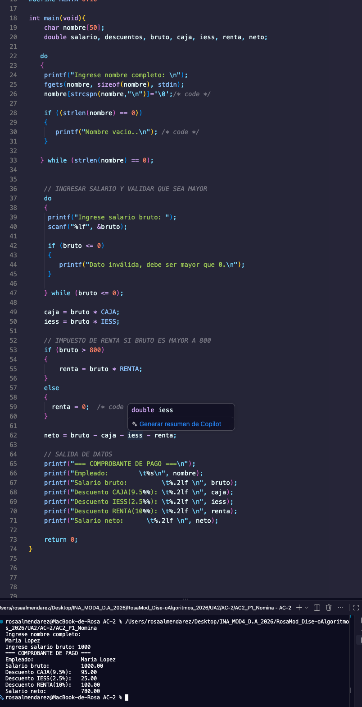
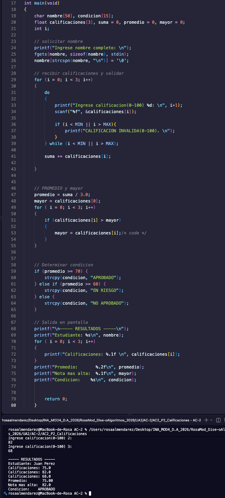

# AC2 · Mi primera aplicación en C

**Estudiante:** (Rosa Almendarez barcenas)  
**Fecha:** 20/10/2026  
**Módulo:** CSTI12010 Diseño de algoritmos · UA2

## Problema 1 · Nómina (AC2_P1_Nomina.c)

| Datos de entrada | Proceso | Datos de salida | Limitaciones |
|---|---|---|---|
| Nombre y salario | Que salario no sea negativo, calcular rebajos y calcular deducciones | Nombre, salario bruto, neto y deducciones | Numeros positivos, identificar mal las variables |

**Ejecución con los datos del ejemplo:**

## Problema 2 · Calificaciones (AC2_P2_Calificaciones.c)

| Datos de entrada | Proceso | Datos de salida | Limitaciones |
|---|---|---|---|
| Nombre, tres calificaciones | Cada calificion debe estar en rango 0-100,calcular promedio y calificacion mayor y determinar condicion | Nombre de estudiante, calificaciones, promedio, nota mas alta y condicion | Solo numeros positivos, y un solo estudiante a la vez |

**Ejecución con los datos del ejemplo:**

## Problema 3 · Compras (AC2_P3_Compras.c)

| Datos de entrada | Proceso | Datos de salida | Limitaciones |
|---|---|---|---|
|  |  |  |  |

**Ejecución con los datos del ejemplo:**

## Conclusión

(Qué aprendí y qué fue lo más difícil de pasar de PSeInt a C.)
